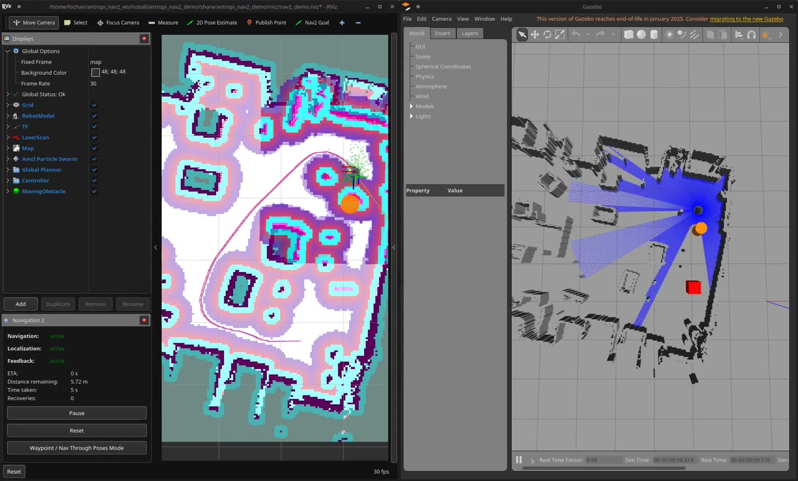

# TurtleBot3 + Nav2 in a real lab map

A reproducible autonomous-navigation demo for the Antropi Robotics software intern
assignment: a TurtleBot3 Burger drives to goals in Gazebo Classic with ROS 2 Nav2,
avoiding furniture, an unmapped box and a moving obstacle.

The environment is not one of the stock TurtleBot3 worlds. It is the 9 x 7 m lab that my
own robot mapped during my internship ([`ros2-lidar-inertial-slam`](https://github.com/Lochan25526/ros2-lidar-inertial-slam)).
The occupancy grid is used as-is by Nav2, and a Gazebo world is generated from it so the
simulated LiDAR sees exactly the walls AMCL expects. The moving obstacle re-uses the motion
logic of the dynamic-obstacle node from my
[`ros2-nav2-navigation-sim`](https://github.com/Lochan25526/ros2-nav2-navigation-sim) repo,
ported from a costmap-only trick to a real Gazebo model.



The 82 s screen recording of the run is in [`docs/media/demo_recording.mp4`](docs/media/demo_recording.mp4)
(RViz on the left, Gazebo on the right, goals sent by `send_goal`). Ground-truth tracks of the
same run: [`docs/results/gui_recorded_run.png`](docs/results/gui_recorded_run.png).

## What happens when you launch it

One command starts Gazebo, the robot, Nav2, RViz and the obstacles. The robot spawns at the
north-east corner of the lab and AMCL is seeded with the same pose, so there is nothing to
click before sending a goal. The default route (`send_goal` with no arguments) is:

1. South down the east strip to the corner at (-2.7, -0.3). On the way the robot meets an
   orange cylinder patrolling across the strip and a red box that is not in the map.
2. West under the tables to the pocket at (-4.3, 1.3).
3. Back to the start.

Both obstacles are detected only through the simulated LiDAR. The planner re-plans at 1 Hz
and the DWB controller stops and waits when the cylinder blocks its path, then continues.

## Tested with

| Component | Version |
|---|---|
| Ubuntu | 22.04.5 |
| ROS 2 | Humble |
| Gazebo | Classic 11.10 (`gazebo_ros_pkgs` 3.9) |
| Nav2 | 1.1.20 |
| TurtleBot3 packages | `turtlebot3_gazebo` 2.3.8, `turtlebot3_navigation2` 2.3.6 |
| Hardware used for the tests | 14-core laptop CPU, Intel integrated graphics, real-time factor 0.99 with the GUI on |

Modern Gazebo (Ignition / gz-sim) is not used anywhere. Everything comes from the Ubuntu
apt repositories.

## Install and build

```bash
sudo apt install ros-humble-desktop ros-humble-gazebo-ros-pkgs \
  ros-humble-turtlebot3-gazebo ros-humble-turtlebot3-navigation2 \
  ros-humble-navigation2 ros-humble-nav2-bringup ros-humble-nav2-simple-commander \
  python3-colcon-common-extensions python3-numpy python3-yaml python3-pil

mkdir -p ~/antropi_nav2_ws/src && cd ~/antropi_nav2_ws/src
git clone https://github.com/Lochan25526/antropi-turtlebot3-nav2.git antropi_nav2_demo
cd ~/antropi_nav2_ws
source /opt/ros/humble/setup.bash
rosdep install --from-paths src -y --ignore-src   # optional, the apt line above covers it
colcon build --symlink-install
source install/setup.bash
```

`TURTLEBOT3_MODEL` does not need to be set; the launch file reads the model name from its
own `model` argument (default `burger`).

## Run

```bash
source ~/antropi_nav2_ws/install/setup.bash
ros2 launch antropi_nav2_demo demo.launch.py
```

Gazebo takes 10 to 20 s to load the 1174 wall boxes. Nav2 reports `Managed nodes are
active` twice (localization and navigation), and the RViz "Navigation 2" panel turns green.

Then, in a second terminal, either click **Nav2 Goal** in RViz and place a goal, or run the
scripted route:

```bash
source ~/antropi_nav2_ws/install/setup.bash
ros2 run antropi_nav2_demo send_goal              # the three-goal demo route
ros2 run antropi_nav2_demo send_goal -- -4.3 1.3 3.14   # one goal: x y yaw
```

`send_goal` prints the distance remaining every two seconds and exits non-zero if any goal
fails, so it doubles as a smoke test.

Useful launch arguments (`ros2 launch antropi_nav2_demo demo.launch.py --show-args` lists all):

| Argument | Default | Meaning |
|---|---|---|
| `gui` / `rviz` | `true` | set either to `false` for a headless run |
| `obstacle` | `true` | spawn and drive the moving cylinder |
| `obstacle_mode` | `patrol` | `patrol` walks between two points; `crossing` is the original internship behaviour (see below) |
| `obstacle_speed` | `0.15` | m/s |
| `patrol` | `-2.7,1.9,-1.7,1.9` | patrol segment `x0,y0,x1,y1` in the map frame |
| `static_obstacle` | `true` | spawn the unmapped red box |
| `static_x`, `static_y` | `-2.0`, `0.4` | where the box goes |
| `x_pose`, `y_pose`, `yaw` | `-1.9`, `2.75`, `-1.5708` | spawn pose; AMCL's `initial_pose` in `config/nav2_params.yaml` must match |
| `map`, `world`, `params_file` | package files | swap in your own |

To stop, Ctrl-C the launch terminal. Nav2 runs without composition here, so shutdown takes
about two seconds and leaves nothing behind.

## How the pieces fit

```
Gazebo Classic (worlds/lab.world)            Nav2 (nav2_bringup, config/nav2_params.yaml)
  turtlebot3_burger model.sdf  --/scan-->      map_server  <- maps/lab_map.yaml
    diff-drive plugin  <--/cmd_vel--           amcl        -> map->odom TF
                       --/odom, odom->base_footprint TF    planner_server (NavFn) / controller_server (DWB)
  moving_obstacle, static_box models           behavior_server, bt_navigator, velocity_smoother
  gazebo_ros_state plugin <-- dynamic_obstacle node (set_entity_state at 10 Hz)
robot_state_publisher: base_footprint -> base_link -> base_scan, wheels
```

Frames: `map -> odom -> base_footprint -> base_link -> base_scan`. The map origin is also the
Gazebo world origin, so the spawn pose and the AMCL initial pose are the same numbers.

## Where the assets come from

| Asset | Origin | Licence |
|---|---|---|
| `maps/lab_map.pgm` | Byte-identical copy of `maps/lab_map.pgm` from my `ros2-lidar-inertial-slam` repo: SLAM Toolbox map of the internship lab, recorded on a Raspberry Pi robot with an RPLIDAR A2 and an ICM-20948 IMU. 306 x 234 cells at 0.03 m. | MIT (mine) |
| `maps/lab_map.yaml` | Same source, with one change: `free_thresh` 0.25 -> 0.196 so that the grey "unknown" pixels (value 205) load as unknown instead of free. With 0.25 they are treated as free space and the planner happily routes through the outside of the building. | MIT (mine) |
| `worlds/lab.world` | Generated by `scripts/map_to_world.py` from the map above: every occupied cell becomes part of a 0.5 m tall static box (5141 cells merged into 1174 boxes). Regenerate with `python3 scripts/map_to_world.py maps/lab_map.yaml worlds/lab.world --camera=-3.1,1.0,6.5,1.5`. | Apache-2.0 (this repo) |
| `antropi_nav2_demo/dynamic_obstacle.py` | Port of `dynamic_obstacle.py` from my `ros2-nav2-navigation-sim` repo. The original had no physics world and painted a fake blob into a LaserScan that only the costmaps subscribed to. This version keeps its state machine and parameter names (`cross_distance`, `cross_width`, `idle_duration`, ...) but moves a real Gazebo model, and adds the `patrol` mode and a yield rule. | Apache-2.0 (mine) |
| `models/moving_obstacle`, `models/static_box` | New, written for this assignment. | Apache-2.0 (this repo) |
| `config/nav2_params.yaml` | Started from `turtlebot3_navigation2/param/humble/burger.yaml` (ROBOTIS). Every change is marked `CHANGED` in the file. | Apache-2.0 |
| `rviz/nav2_demo.rviz` | `nav2_bringup/rviz/nav2_default_view.rviz` with unused displays removed, the robot model enabled, a marker for the obstacle and a top-down view. | Apache-2.0 |
| Robot model and URDF | Loaded at runtime from the installed `turtlebot3_gazebo` package, not copied. | Apache-2.0 |

My other internship assets were checked and not used: the `indoor_bot` world is written
for Ignition Gazebo and the ADAS project runs in Webots, so neither fits a Gazebo Classic
setup, and the `bcr_bot` warehouse is third-party, not internship work.

## Test results

All runs use the default route and were driven by `scripts/nav_test.py`, which records
Gazebo ground truth at 10 Hz, counts global re-plans and recoveries, and checks the closest
approach to each obstacle (a collision would be a centre distance below 0.255 m, robot radius plus
obstacle radius or half-width). Raw JSON and plots are in `docs/results/`.

| Run | Leg times (s) | Recoveries | Path | Closest to cylinder | Closest to box | Result |
|---|---|---|---|---|---|---|
| No obstacles (baseline) | 19.3 / 18.4 / 21.6 | 0 | 9.2 m | n/a | n/a | 3/3 reached |
| Patrol cylinder + box, headless | 26.8 / 18.6 / 19.6 | 0 | 9.3 m | 0.56 m | 0.37 m | 3/3 reached |
| Same, fresh restart | 30.4 / 19.3 / 22.8 | 1 | 9.8 m | 0.29 m | 0.37 m | 3/3 reached |
| Same, with Gazebo GUI and RViz (the recorded run) | 27.4 / 18.1 / 20.8 | 0 | 9.3 m | 0.53 m | 0.37 m | 3/3 reached |
| `obstacle_mode:=crossing` (experimental) | 117.6 / 18.4 / 22.6 | 9 | 9.5 m | 0.58 m | 0.40 m | 3/3 reached |

What the first leg looks like with the obstacles: the robot sets off, stops for about six
seconds while the cylinder crosses in front of it, then drives on at full speed and passes the
box on its open side (`docs/results/headless_patrol_box_timeseries.png`). The 0.29 m closest
approach in the restart run happened before the yield rule was added to the obstacle node;
after it the obstacle pauses whenever the robot is within 0.4 m, so a waiting robot can no
longer be run over by a kinematically moved model.

Verified by hand on top of the harness: all Nav2 lifecycle nodes activate, `/scan` at 5 Hz,
`/odom` at 30 Hz, `/clock` from Gazebo, the full TF chain, `/map` loads with 5141 occupied
and 29708 unknown cells, both costmaps publish, and the system restarts cleanly after Ctrl-C.

Not verified: behaviour with the `waffle` models (the launch argument exists but only
`burger` was run), and anything about a real robot.

## Recording the demo

`docs/media/demo_recording.mp4` was made with `ffmpeg` grabbing the screen while
`send_goal` drove the default route, with RViz and Gazebo side by side. To reproduce:

```bash
ros2 launch antropi_nav2_demo demo.launch.py          # terminal 1, arrange the two windows
ffmpeg -f x11grab -framerate 25 -video_size 1920x1080 -i :0.0 -t 120 demo.mp4   # terminal 2
ros2 run antropi_nav2_demo send_goal                  # terminal 3, or click Nav2 Goal in RViz
```

Stop `ffmpeg` with `q` once the robot is back at the start. The route takes 65 to 80 s.

## Known limitations

- The moving obstacle is teleported in small steps, not driven by physics. It has collision
  geometry, so the LiDAR sees it, but it cannot be pushed and it pauses rather than collide.
- `crossing` mode deliberately re-anchors the obstacle 1.6 m ahead of the robot every few
  seconds. It never caused a collision in testing but it triggers a lot of recoveries and a
  slow first leg, so it is kept as an experiment, not as the demo setting.
- The lab map is a real SLAM map with specks from chair legs and scan noise. Each speck is a
  3 cm pillar in the world. Inflation is tuned (0.3 m, scaling 6.0) so the 0.6 m lanes between
  them stay usable; the stock TurtleBot3 inflation made NavFn prefer an 8 m detour over a 3 m lane.
- The first goal sometimes needs one recovery (spin or back-up) when the cylinder parks in the
  robot's path for longer than the 10 s progress-checker window.
- NavFn is not allowed to plan through unknown space. Goals outside the mapped area will be rejected.

## Layout

```
antropi_nav2_demo/            ROS 2 package root (this repo)
  antropi_nav2_demo/
    dynamic_obstacle.py       moves the cylinder through /gazebo/set_entity_state
    send_goal.py              sends the route through nav2_simple_commander
    nav_wait.py               waits for Nav2 without publishing an initial pose
  launch/demo.launch.py       the single entry point
  config/nav2_params.yaml     Nav2 parameters, every change from stock marked
  maps/lab_map.{pgm,yaml}     the internship map
  worlds/lab.world            generated Gazebo world
  models/                     moving_obstacle, static_box
  rviz/nav2_demo.rviz
  scripts/map_to_world.py     map -> world generator
  scripts/nav_test.py         instrumented test runner
  docs/results/               JSON + plots from the runs in the table above
  docs/media/                 the screen recording and stills from it
  SUBMISSION_ANSWERS.md       answers to the application questions
```

## Licence

Apache-2.0, see `LICENSE`. The map is MIT-licensed from my own repository; the Nav2
parameter file and RViz configuration are derived from Apache-2.0 files by ROBOTIS and the
Nav2 maintainers.
